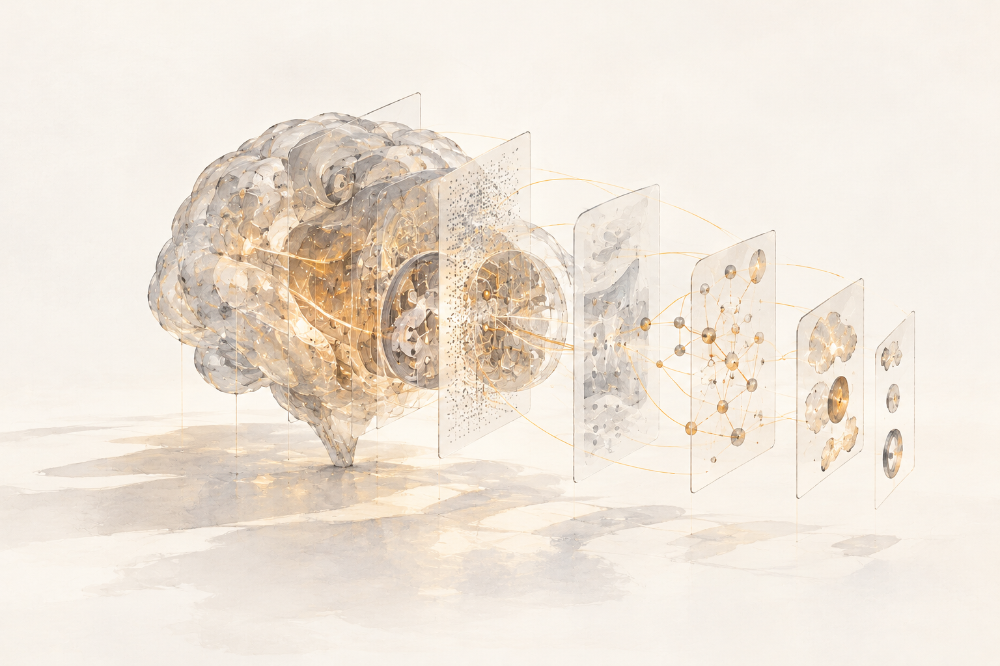

# Hi, I'm Emilio 👋

**Applied mathematics undergraduate** working where geometry, algebra, and learning systems meet.
I'm interested in *why* neural networks work — what structure they discover, how geometry constrains them, and their ability to represent concepts.

> Currently: writing my bachelor's thesis on the mechanistic interpretability of AlphaFold, and preparing for graduate study in interpretability.

---

  

## 🧠 Career goals
Aiming to contribute towards a complete theory of deep learning and solving the intelligence problem.

## 🔬 Research interests

- **Mechanistic interpretability** — sparse autoencoders, activation patching, and formal concept analysis over learned features.
- **Geometric deep learning** — SE(3)/SO(3)-equivariant architectures, Lie group representations.
- **Protein structure ML** — AlphaFold 2/3, RoseTTAFold, diffusion on SE(3) frames.
- **Applied algebraic topology** — persistent homology and topological data analysis on time series.

## 🧪 Current & recent work

### Interpreting AlphaFold's Pairformer *(bachelor's thesis, in progress)*
Does AlphaFold represent intrinsic properties (e.g. hydrophobicity) that it then translates into geometry? Does evolutionary signal propagate into its predictions in identifiable ways? Rather than the diffusion module, this work targets the **Pairformer** and its triangular attention, at the level of heads and circuits.

### Persistent homology from first principles → TDA-EEG pipeline
A mathematics paper building persistent homology from the ground up and applying it to EEG as a tool to classify two brain states.

## 🛠️ Tools

  
  
  
  
  
  
  

## 🌱 Also thinking about

Information theory · mathematical physics · quantum mechanics · hybrid intelligence · philosophy of mind — I write essays on intelligence and consciousness.

## 📫 Reach me

  
  
  

---

*"The universe is written in the language of mathematics."* — Galileo
